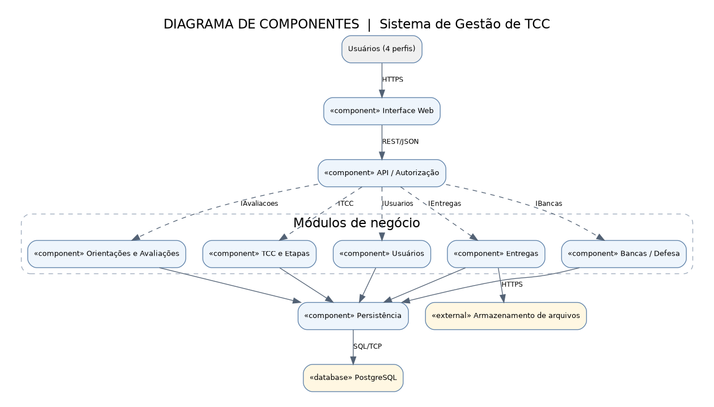
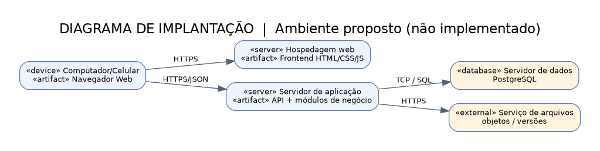
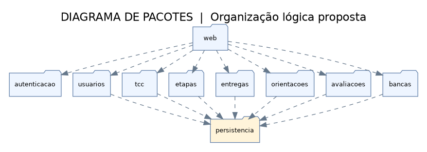

# Documento de Arquitetura — Sistema de Gestão de TCC

**Projeto Integrador — Análise e Projeto de Sistemas — UNISC — 2026/2**  
**Integrantes:** Diogo Alex Marquardt, Wilhelm Niemeyer Bock, Bruno Comassetto e Matheus Rocha Barreto.

## 1. Visão geral
O Sistema de Gestão de Trabalho de Conclusão de Curso organiza e acompanha o TC1 e o TC2: cadastro dos participantes, associação entre aluno e orientador, etapas e prazos, orientações, entregas versionadas, feedback, admissibilidade, composição de banca e avaliação final. Seu objetivo é centralizar registros, permitir consultas conforme o papel do usuário e preservar o histórico acadêmico. O documento descreve uma **arquitetura proposta**, não uma implementação já concluída.

## 2. Padrão arquitetural
Propõe-se um **monolito modular em camadas**, com interface web, API/serviços de negócio e persistência. O padrão simplifica o MVP acadêmico, permite validação centralizada de permissões e facilita manutenção das regras de entrega, avaliação e progresso. Separar funcionalidades em módulos de negócio evita misturar responsabilidades. A escolha, alternativas e consequências constam no [ADR-001](arquitetura/ADR-001-arquitetura-em-camadas.md).

## 3. Diagrama de componentes

O frontend fornece as telas para os quatro perfis; a API autentica e verifica permissões, expõe operações via REST/JSON e coordena os serviços de usuários, TCC e etapas, entregas, orientações/avaliações e bancas. A persistência gerencia os registros em banco relacional. O armazenamento externo conserva arquivos/versões das entregas. Interfaces de serviço: `IUsuarios`, `ITCC`, `IEntregas`, `IAvaliacoes` e `IBancas`. As dependências apontam dos consumidores para os serviços que utilizam.

## 4. Diagrama de implantação

Ambiente **conceitual** proposto: usuários acessam o frontend por HTTPS; o navegador chama a API em HTTPS/JSON; a aplicação consulta o PostgreSQL por TCP/SQL e usa um serviço de arquivos por HTTPS. Os artefatos são frontend web e aplicação backend. Os hosts, provedores e endereços ainda não foram escolhidos, portanto não são apresentados como infraestrutura em operação. Componentes e implantação são consistentes: interface, API, banco e armazenamento aparecem nos dois diagramas.

## 5. Organização lógica (diagrama de pacotes)

Os pacotes `autenticacao`, `usuarios`, `tcc`, `etapas`, `entregas`, `orientacoes`, `avaliacoes`, `bancas`, `persistencia` e `web` organizam responsabilidades. Módulos de negócio dependem de persistência, evitando dependências circulares entre módulos.

## 6. Decisões arquiteturais (ADRs)
- [ADR-001 — Arquitetura em camadas](arquitetura/ADR-001-arquitetura-em-camadas.md)
- [ADR-002 — Controle de acesso e rastreabilidade](arquitetura/ADR-002-acesso-e-rastreabilidade.md)

## 7. Atributos de qualidade (RNFs)
| Atributo | Tratamento arquitetural proposto |
| --- | --- |
| Segurança | Autenticação e autorização no backend por perfil e vínculo com cada TCC; HTTPS. |
| Integridade | Banco relacional e transações para alterações de entregas, etapas e avaliações. |
| Rastreabilidade | Registrar autor, data/hora, situação e histórico de versões de entregas e avaliações. |
| Manutenibilidade | Módulos de negócio separados e dependências claras, com regras de domínio centralizadas. |
| Disponibilidade | Backups e restauração do banco/arquivos devem fazer parte da operação futura. |
| Usabilidade | Painel por perfil, com prazos, andamento, pendências e feedbacks. |

## 8. Rastreabilidade para requisitos anteriores
| Casos de uso | Módulo principal |
| --- | --- |
| UC01 | Usuários / autenticação |
| UC02, UC03, UC10 | TCC / etapas / acompanhamento |
| UC04 | Orientações |
| UC05 | Entregas e armazenamento de arquivos |
| UC06, UC07, UC09 | Avaliações / pareceres |
| UC08 | Bancas |

**Ponto a validar:** a Parte 2 descreve momentos diferentes para a composição da banca (logo após o cadastro ou depois da admissibilidade). A decisão de processo deve ser consolidada com o professor antes de codificar as validações.

## 9. Estado do projeto e referências
Esta entrega corresponde à documentação acadêmica e aos modelos propostos; não inclui sistema executável. Requisitos e critérios de aceitação estão no [PI Parte 2](../materiais_anteriores/PI_Parte_2.pdf). Diagramas editáveis estão em `diagramas/*.puml` e imagens em `diagramas/*.png`. 
